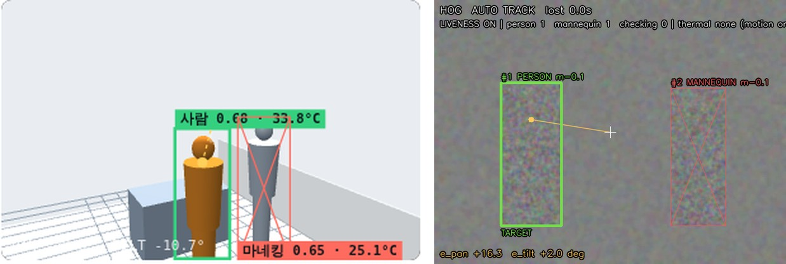
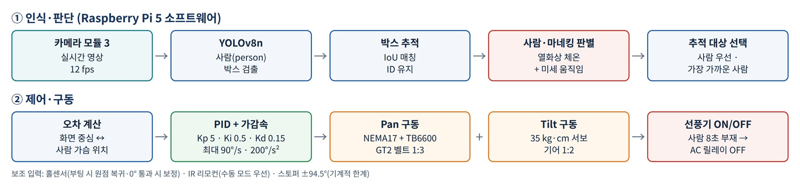

# 자동 추적 선풍기 V3 — 웹캠 추적 · 사람/마네킹 구분 데모

AI 비전 기반 **벽걸이형 2축(Pan·Tilt) 자동 추적 선풍기**의 인식·제어 로직을 노트북 웹캠으로 체험하는 데모입니다.
라즈베리파이 5에 올릴 것과 같은 로직(YOLOv8n 사람 인식 → 사람/마네킹 판별 → PID + 가감속 제어 → 자동 OFF)으로 화면 속 '가상 선풍기'가 사람을 따라갑니다.

> 2026 명지대학교 기계공학과 동문 아이디어 챌린지 (생활문제해소분야) · 팀 **FOR**



- **3D 추적 시뮬레이터(웹)**: https://vercel-deploy-five-chi-82.vercel.app

## 주요 기능

| 기능 | 내용 |
|---|---|
| 사람 인식 | YOLOv8n (ultralytics 설치 시 자동 사용), 없으면 OpenCV HOG |
| 사람/마네킹 구분 | 박스 안 미세 움직임 − 주변 배경 움직임(카메라 회전 상쇄), 라즈베리파이에선 MLX90640 열화상 체온까지 사용 |
| 추적 제어 | Pan·Tilt PID(Kp 5, Ki 0.5, Kd 0.15) + 최대 속도 90°/s, 가속도 200°/s² 제한 |
| 자동 OFF | 실제 사람이 8초간 없으면 선풍기 OFF (마네킹만 보이는 경우 포함) |
| 데이터 기록 | `tracking_log_날짜.csv` — 오차, 각도, 검출 여부, 판별 상태 |



## 실행 방법

```bash
pip install -r requirements.txt        # ultralytics는 선택 (YOLOv8n)
python webcam_tracking_demo.py         # 기본 웹캠
python webcam_tracking_demo.py --video 영상.mp4
python webcam_tracking_demo.py --detector hog     # YOLO 없이
```

`liveness.py`는 `webcam_tracking_demo.py`와 같은 폴더에 있어야 합니다.
macOS는 처음 실행할 때 **시스템 설정 › 개인정보 보호 및 보안 › 카메라**에서 터미널을 허용하세요.

### 조작 키

| 키 | 동작 |
|---|---|
| A / M | 자동 추적 / 수동 모드 |
| ← → ↑ ↓ | 수동 이동 (수동 모드) |
| P | 선풍기 전원 |
| L | 사람·마네킹 구분 ON/OFF |
| R | 지표 초기화 |
| Q | 종료 |

화면 표시: 초록 **PERSON** = 실제 사람(추적 대상) · 노랑 **CHECKING** = 판별 중 · 빨강 X **MANNEQUIN** = 마네킹/사진(무시)

## 라즈베리파이 5 + 열화상 센서 (실제 장치)

```bash
pip install ultralytics adafruit-circuitpython-mlx90640 --break-system-packages
python webcam_tracking_demo.py --ncnn --thermal mlx90640 --camera-moves
```

- `--ncnn`: YOLOv8n을 처음 1회 NCNN 형식으로 변환해 라즈베리파이에서 더 빠르게 실행
- `--thermal mlx90640`: MLX90640(I2C 0x33) 체온으로 사람/마네킹 판별 (없으면 `auto`가 움직임 판별만 사용)
- `--camera-moves`: 카메라가 선풍기 헤드와 함께 회전하는 실제 장치일 때

MLX90640 배선: VIN→3.3V(1번 핀), GND→GND(6번), SDA→GPIO2(3번), SCL→GPIO3(5번)

## 파일

| 파일 | 설명 |
|---|---|
| `webcam_tracking_demo.py` | 웹캠 추적 데모 (인식·제어·가상 선풍기 화면·CSV 로그) |
| `liveness.py` | 사람/마네킹 판별 모듈 (IoU 추적, 미세 움직임, 열화상, 위치 기억) |
| `requirements.txt` | 필요한 패키지 |
